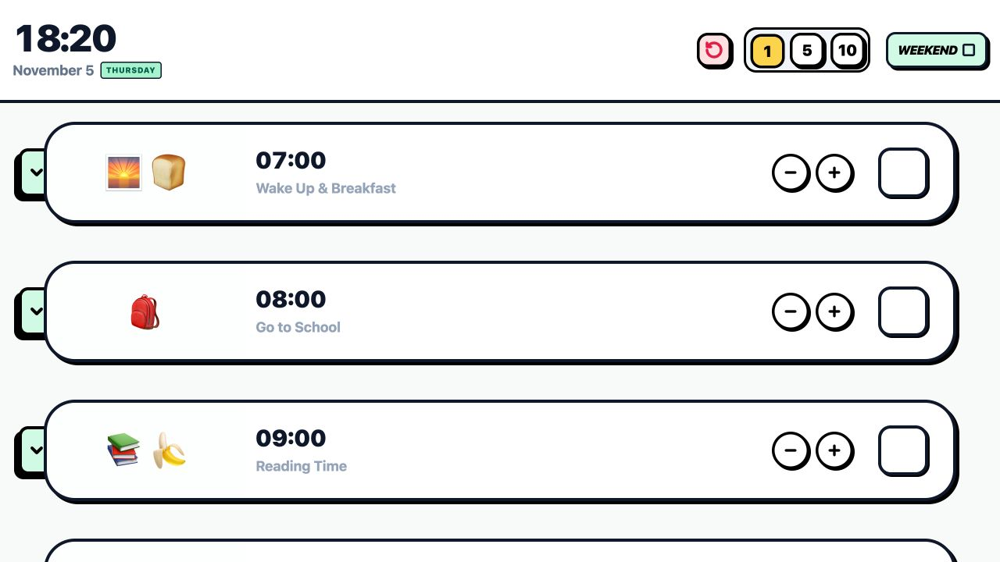

# 4岁宝宝作息时间表

**看看现在该做什么，做完就打个勾。**

一张给 4 岁宝宝和家长一起看的互动式作息表。从起床、吃饭、玩耍到睡觉，把一天拆成一张张容易辨认的卡片。

[**在线打开作息表**](https://dounaoo.github.io/toddler-daily-routine/)

## 怎么用

- 切换工作日和周末，查看两套作息。
- 用活动旁的加减按钮调整时间，完成后打勾。
- 展开活动旁的对话标签，可以听家长和孩子的英语示例。
- 点击顶部的刷新按钮，清空当天的勾选并恢复默认时间。
